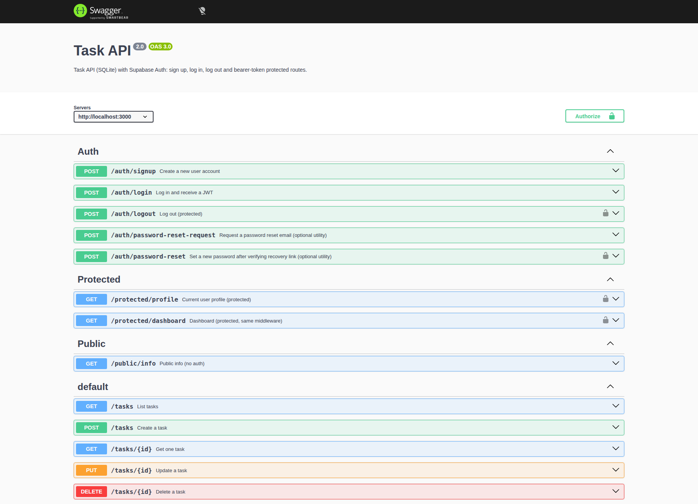

# Secure CRUD API — FlyRank Internship A4 (Auth · Login & Protect)

A **Node.js + Express** backend that adds **Supabase authentication and JWT-protected routes** to the existing SQLite CRUD project. This repository is the continuation of the earlier CRUD and database assignments; **A4 / W4 Auth is the current assignment**.

## Current assignment: Authentication (A4 / W4)

Supabase Auth registers users, checks passwords, and issues access tokens. This Express server uses `supabase.auth.getUser(token)` to verify each incoming bearer token before revealing private routes. No passwords are stored or hashed by the server.

### Requirements checklist

| PDF stage | Feature | Implementation |
|---|---|---|
| Stage 0 | Supabase client, private `.env`, server | `index.js`, `.env.example`, `.gitignore` |
| Stage 1 | Signup / login, 400/401, access + refresh tokens | `POST /auth/signup`, `POST /auth/login` |
| Stage 2 | Public and protected endpoints | `GET /public/info`, `GET /protected/profile` |
| Stage 3 | Verify bearer JWT with Supabase | `authClient().auth.getUser(token)` |
| Stage 4 | Reusable middleware, protected logout, second private route | `requireAuth`, `POST /auth/logout`, `GET /protected/dashboard` |
| Stage 5 | Swagger UI bearer authorization | `openapi.json`, `GET /docs` |
| Stage 6 | Public GitHub repo, README, example env | This repository |

The code implements each stage. **Real Supabase end-to-end success still requires the local project credentials and a successful smoke test**; passing mocked tests alone is not proof of successful login.

### Technology

**JavaScript · Node.js 22+ · Express · Supabase Auth · JWT · Swagger UI · SQLite (better-sqlite3) · GitHub Actions**

### 1. Install & configure (Windows)

```powershell
git clone https://github.com/DipanshuG63/CRUD-API.git
cd CRUD-API
npm ci
Copy-Item .env.example .env
```

Edit your **local** `.env` file:

```env
SUPABASE_URL=https://YOUR-PROJECT.supabase.co
SUPABASE_KEY=YOUR_PUBLIC_ANON_OR_PUBLISHABLE_KEY
PORT=3000
```

Find the Project URL and **public anon/publishable key** in your [Supabase Dashboard](https://supabase.com/dashboard). Do **not** use a `service_role`/secret key. This practice assignment recommends switching off **Confirm email** under Supabase Authentication email-provider settings so that a newly registered test account can log in immediately. Keep email verification enabled for real production apps.

**Security:** `.gitignore` excludes `.env` and `.env.*` while allowing `.env.example`. This means actual local credentials are not uploaded by normal `git add` commands. The public example contains placeholders only.

### 2. Start the API

```powershell
npm start
```

- API: <http://localhost:3000>
- Swagger UI: <http://localhost:3000/docs>
- Health check: <http://localhost:3000/health>

### 3. Authentication endpoint reference

| Method | Route | Auth required | Expected success | Typical error |
|---|---|---|---|---|
| POST | `/auth/signup` | No | 201 Created | 400 missing/invalid input |
| POST | `/auth/login` | No | 200 with `access_token` and `refresh_token` | 400 missing fields; 401 login rejected |
| POST | `/auth/logout` | **Bearer JWT** | 204 No Content | 401 missing/invalid JWT |
| GET | `/protected/profile` | **Bearer JWT** | 200 with `id`, `email`, `created_at` | 401 missing/invalid JWT |
| GET | `/protected/dashboard` | **Bearer JWT** | 200 | 401 missing/invalid JWT |
| GET | `/public/info` | No | 200 Welcome stranger | — |

Supabase network failures return a JSON `502` error. An invalid/malformed bearer header returns `401`. The `requireAuth` middleware is reused for the private profile, dashboard and logout routes.

### 4. Test via Swagger

1. Open <http://localhost:3000/docs> and expand **POST /auth/signup**.
2. **Try it out**: enter an email and password, then **Execute** (expect **201**).
3. Expand **POST /auth/login**, log in with the same credentials (expect **200**).
4. Copy **only the value** of `access_token` — a long JWT beginning with `eyJ...`. **Do not copy `"access_token":`, quotes, `Bearer`, or the entire JSON response.**
5. Click the **Authorize** button at the top of Swagger and paste **only that JWT**. Swagger automatically sends `Authorization: Bearer eyJ...`.
6. Execute **GET /protected/profile** (expect **200** and your profile), then **GET /protected/dashboard** (expect **200**).
7. Replace one character of the token and retry (expect **401**). Clear authorization and retry (expect **401**).
8. Execute **POST /auth/logout** with a valid token (expect **204**). Discard access and refresh tokens on the client after logout.

**Note:** Logout invalidates the refresh-token session; an already-issued access JWT can remain usable until its expiry. This is a known JWT lifecycle limitation, not proof that logout failed.

### 5. Automated tests

```powershell
npm test                   # local mocked route tests (no Supabase credentials)
npm run test:smoke         # real signup/login/JWT/logout against YOUR Supabase project
npm run capture:swagger    # captures real browser Swagger UI to docs/swagger-auth.png
```

The real smoke test creates a disposable test user. The screenshot command requires Chrome, Edge or Chromium on the machine. `test:smoke` and `capture:swagger` require a private, configured `.env`; the mocked `npm test` does not.

GitHub Actions workflow: [W4 Auth API tests](.github/workflows/w4-auth-tests.yml). It runs the mocked tests and checks API startup, the public route, the locked profile route, and the Swagger page on pushes.

### 6. Swagger screenshot



The screenshot demonstrates the Swagger UI **protected-route padlock**. It is deliberately cropped to avoid publishing a real JWT. An authorized `200` response must be confirmed in the live smoke test; the screenshot alone is not evidence of a successful login.

### 7. GitHub publishing & secret checks

```powershell
git check-ignore -v .env
git ls-files .env
git status
git add .
git commit -m "W4: complete and document authentication"
git push origin main
```

`git check-ignore -v .env` should print the matching ignore rule. **`git ls-files .env` must print nothing.** If it ever prints `.env`, stop and untrack it using `git rm --cached .env` before pushing. Removing a secret from the newest commit does not remove it from Git history; rotate compromised credentials if they were ever published.

## Password recovery (optional, for the existing Gmail account)

This is **extra functionality** to help with the real-world recovery-link problem, not a mandatory A4 endpoint. The original Supabase password-reset email redirected to `http://localhost:3000/#error=...`; the old API returned JSON there, so no password form appeared.

The API now serves a browser-friendly password recovery page at **<http://localhost:3000/reset-password>** and at `http://localhost:3000/` when visited in a normal browser (so Supabase's currently configured default Site URL works).

1. Run `git pull origin main`, `npm ci` (if needed), and `npm start`.
2. Open <http://localhost:3000/reset-password> in Chrome.
3. Enter the **same existing Gmail** and click **Send password reset email**. No new account or Gmail alias is needed.
4. Open the **newest** reset email promptly **once** while the local server is running. Supabase verifies the email and redirects to the browser password form.
5. Set a new password on that form, then open <http://localhost:3000/docs> and try `POST /auth/login` with the same Gmail and new password. A successful login returns a JWT.

The two extra endpoints are `POST /auth/password-reset-request` (request email) and `POST /auth/password-reset` (verified bearer token + new password). Passwords are only sent to Supabase for updating, not stored in the CRUD database. The browser removes recovery tokens from the URL without storing them.

If the email redirects with `otp_expired`, request a **new** email from the page and open only its fresh link. Recovery links are short-lived/single-use and can sometimes be consumed by automated email scanning. The exact return URL is configured under **Supabase Dashboard → Authentication → URL Configuration**; the current practice project Site URL is `http://localhost:3000`. If you change that later, update it to the actual app URL.

**Security:** Do not share screenshots containing passwords, reset links, raw JWTs, or refresh tokens. If a real password was visible in an earlier screenshot, replace it with a unique one.

## Previous assignments retained for continuity (A1–A3)

This is intentionally the **same repository**, extended week by week. Earlier stages remain implemented but are not the focus of the A4 submission.

- **A1:** Express REST API with `GET /tasks`, `GET /tasks/:id`, `POST /tasks`, `PUT /tasks/:id`, `DELETE /tasks/:id`; Swagger documentation.
- **A2/A3:** SQLite persistence, prepared statements, seed records, filters/search, statistics and database extras.
- **A4:** Authentication, reusable JWT guard, protected endpoints, Supabase logout and Swagger bearer scheme.

SQLite creates the local `tasks.db` automatically on first run. It is excluded by `.gitignore`. Previous Swagger screenshots are kept in `docs/` for historical context; the current authentication screenshot is `docs/swagger-auth.png`.

## Project files

```text
index.js                       Express app, CRUD routes, Supabase auth & JWT guard
openapi.json                   OpenAPI definition with HTTP bearer JWT security
.env.example                   Safe placeholder environment configuration
.gitignore                     Ignores .env, node_modules and SQLite database
test/auth.test.js              Offline mocked auth tests
test/live-smoke.js             Real Supabase end-to-end checks
scripts/capture-swagger.js     Browser screenshot generator
docs/swagger-auth.png          Token-free Swagger bearer padlock screenshot
.github/workflows/             GitHub Actions automated verification
package.json                   Dependencies and npm commands
reset-password.html             Local password-recovery webpage (optional)
README.md                      Assignment A4 documentation
```

### Known verification boundary

The repository contains the implementation and mocked tests. Real signup/login/logout results depend on a properly configured Supabase project. Never put real access tokens, refresh tokens, passwords or project secrets into GitHub commits, screenshots or public issues.
